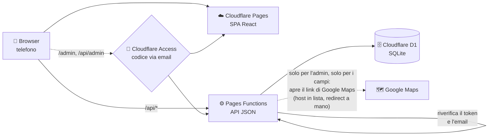
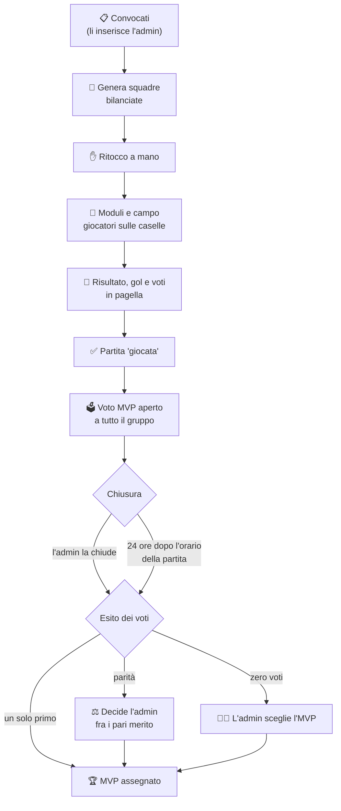
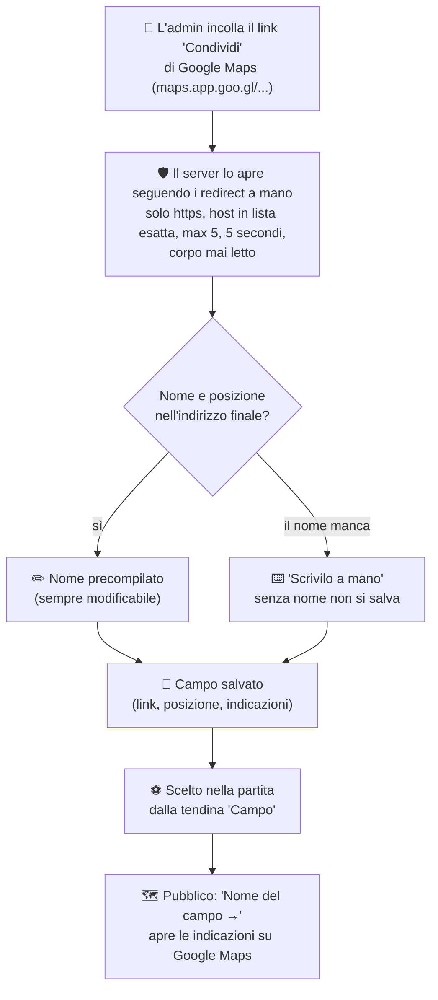
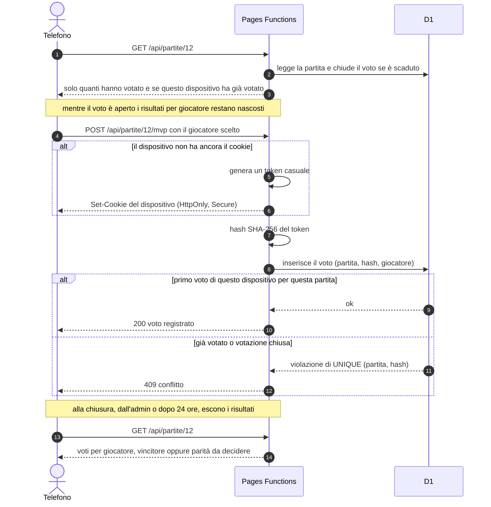
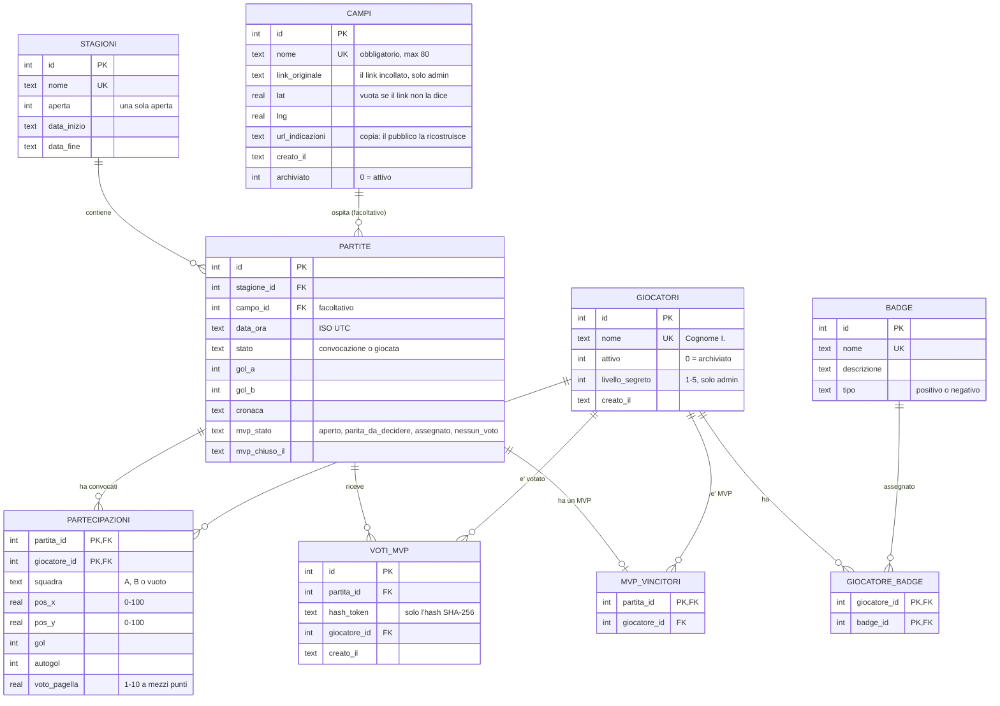

# ⚽ Terzo Tempo

**Le partite di calcetto del gruppo, con classifiche, figurine e MVP votato da tutti.**

Sito: **<https://terzo-tempo.pages.dev>**

Un gruppo di amici, una partita a settimana, squadre rifatte ogni volta. Da telefono si vede subito chi segna di più, chi ha la media voto migliore, chi è stato MVP e come erano schierati i due squadroni. Chi organizza inserisce convocati e risultati, il resto lo fa il sito.

<p align="center">
  
  
  
  
  
  
</p>

---

## Cosa fa

L'app è pensata per un gruppo di circa venti amici che giocano a calcetto e vogliono tenere memoria di quello che succede in campo, quasi sempre **dal telefono**: la grafica è mobile-first, in stile "Figurine" (carta avorio, colori pieni da stampa, tema chiaro e "album di notte").

| Funzione | Cosa si vede |
|---|---|
| **Classifiche** | Gol, presenze, media voto, MVP e percentuale di vittorie. Per stagione oppure "sempre". |
| **Scheda giocatore** | La figurina con i **badge** (Cecchino, Muro, Turista...), le statistiche, gli ultimi cinque risultati (V/P/S) e il grafico dei voti in pagella. |
| **Campo con moduli** | Le formazioni sul campo, in stile fantacalcio: modulo scelto per la partita (per esempio 2-1-2 o 3-2-1) e giocatori sulle loro caselle. |
| **Voto MVP dal telefono** | Ogni partita ha la sua votazione: si vota dal telefono, **senza login**, un voto per dispositivo. |
| **Campo da gioco** | Dove si gioca: ogni partita può avere un campo, e il suo nome è un link che apre **Google Maps sulle indicazioni stradali** (app del telefono, se c'è). L'admin aggiunge un campo incollando il link "Condividi" di Google Maps. |
| **Generatore di squadre** | Dai convocati propone due squadre bilanciate; poi chi organizza ritocca a mano. |
| **Stagioni** | Aperte e chiuse a mano: classifiche per stagione e storico. |
| **Area admin** | Giocatori, badge, campi, stagioni, partite, risultati e MVP. Protetta da Cloudflare Access. |

La parte pubblica è in **sola lettura**, tranne il voto MVP. Tutto il resto lo scrive l'area admin.

---

## Architettura

Una singola pubblicazione su Cloudflare: il frontend è una SPA React servita da Pages, le API sono Pages Functions, i dati stanno in D1. `/admin` e `/api/admin` sono dietro **Cloudflare Access** (codice via email), e il backend riverifica da solo il token.



> Le rotte pubbliche non hanno login. Le rotte admin rispondono 401 o 403 senza un token valido: **mai aperte per errore**.

---

## Flusso di una partita

Dalla convocazione alla chiusura del voto MVP. Le squadre si rifanno a ogni partita e possono avere un numero diverso di giocatori.



Il **campo** è facoltativo e si sceglie da una tendina (o si toglie) in creazione e in modifica della partita. I campi si aggiungono una volta sola, dalla pagina Campi dell'admin, partendo dal link di Google Maps:



La scadenza automatica si calcola sull'**orario della partita**, non su quando la si carica: se l'admin inserisce il risultato in ritardo, nessuno può comunque votare giorni dopo. Non c'è nessun cron: la chiusura viene applicata alla prima lettura o al primo voto successivi.

---

## Il voto MVP

Vota tutto il gruppo, non solo chi ha giocato, senza login e in modo anonimo. Il server riconosce il telefono da un cookie casuale e ne salva **solo l'hash**.



Chi usa la modalità in incognito o un altro browser risulta un dispositivo nuovo: è un limite noto e accettato.

---

## Modello dati

Le squadre nel database sono solo `A` e `B`: i loro nomi arrivano dal codice, in un solo punto. Le date sono ISO 8601 in UTC, l'orario mostrato è quello di Roma.



`VOTI_MVP` ha un vincolo `UNIQUE (partita_id, hash_token)`: un dispositivo, un voto per partita. Un campo si **archivia**, non si cancella: resta sulle partite passate ma non si sceglie più per le nuove. Schema completo in [`migrations/`](migrations/).

---

## Stack

- **TypeScript** ovunque, controllato con `tsc -b`
- **[React](https://react.dev/) 19** + **[Vite](https://vite.dev/)**: SPA con un router minimo sulla History API, senza librerie di routing
- **[Cloudflare Pages](https://pages.cloudflare.com/)** + **Pages Functions**: hosting e API JSON
- **[Cloudflare D1](https://developers.cloudflare.com/d1/)**: database SQLite, con migrazioni in `migrations/`
- **[Cloudflare Access](https://developers.cloudflare.com/cloudflare-one/policies/access/)**: cancello dell'area admin
- **Font self-hosted** ([Anton](https://fontsource.org/fonts/anton) e [Nunito Sans](https://fontsource.org/fonts/nunito-sans) via Fontsource): la CSP non ammette risorse esterne
- **[Vitest](https://vitest.dev/)**: test del backend su un D1 finto e delle funzioni pure del frontend
- **[Playwright](https://playwright.dev/)**: prove nel browser sulla build di produzione

---

## Struttura del progetto

```
├── app/                # frontend
│   ├── index.html
│   ├── public/         # file statici alla radice del sito: manifest, icone, favicon (generati da scripts/genera_icone.mjs)
│   └── src/
│       ├── pagine/     # schermate pubbliche: Home, Classifiche, Partite, Scheda, Info...
│       ├── ui/         # componenti condivisi: Figurina, Campo, Carta, Badges...
│       ├── admin/      # area /admin, caricata a parte con React.lazy
│       ├── lib/        # tipi, chiamate API, logica pura
│       └── stili/      # token, tema chiaro e scuro, stili dei componenti
├── functions/          # Pages Functions: middleware, API pubbliche e admin
│   ├── api/            #   rotte (le admin sotto api/admin)
│   └── lib/            #   accesso, generatore di squadre, MVP, statistiche, campi e link di Google Maps (maps.ts)
├── shared/             # codice comune a frontend e backend: nomi, moduli, indirizzo delle indicazioni
├── migrations/         # schema D1
├── scripts/            # pubblicazione, controllo del sito vero, dati di prova, icone
├── test/               # Vitest (compresa la guardia dei nomi reali)
├── e2e/                # prove nel browser con Playwright
├── docs/               # API, messa in produzione, decisioni aperte, logo sorgente
├── wrangler.toml       # configurazione Cloudflare (nessun segreto)
└── CLAUDE.md           # regole e decisioni del progetto
```

---

## Esecuzione in locale

```bash
git clone https://github.com/chrisCCtwentyone/terzo-tempo.git
cd terzo-tempo
npm install
```

Database locale con i **dati di prova** (giocatori inventati), poi l'app:

```bash
cp .dev.vars.example .dev.vars   # apre l'area admin, ma solo da localhost
npm run db:migra                 # crea le tabelle nel D1 locale
npm run db:seed                  # carica i dati di prova
npm run build                    # il backend locale serve app/dist
npm run dev:api                  # Pages + D1 locale su http://localhost:8788
npm run dev                      # in un altro terminale: Vite su :5173, proxy /api verso :8788
```

### Test

```bash
npm run typecheck   # tsc -b
npm test            # Vitest
npm run e2e         # browser: build di produzione, D1 usa-e-getta, Chromium a 390x844, tema chiaro e scuro
npm run e2e:admin   # come sopra, per l'area admin (con eventi touch veri)
# entrambi contengono il rilevatore di trabocchi di testo (e2e/trabocchi.ts): ogni schermata a 320/360/390/430 px,
# chiaro e scuro, con web font, senza web font (font di ripiego) e con testo ingrandito; E2E_TRABOCCHI=report li conta senza fallire
```

Le prove nel browser controllano tutte le schermate, il voto MVP col conflitto al secondo voto, la chiusura a tempo scaduto, la console senza errori, zero violazioni CSP, nessuna risorsa esterna e nessuno scroll orizzontale. Servono un Chromium già installato e `playwright-core` alla versione fissata: dettagli in [`docs/DEPLOY.md`](docs/DEPLOY.md).

### Logo e icone

Il logo è la **Figurina**: `docs/logo/logo-figurina.svg` (512x512, sfondo giallo pieno) è l'unica sorgente. Da lì nascono l'icona della schermata Home di iPhone, l'icona del sito nel browser e il marchio nell'intestazione (il `<symbol id="logo">` dello sprite in `app/src/ui/Icone.tsx`, inline: nessuna immagine da caricare; un test lo confronta con l'SVG).

Le icone in `app/public` non si ritoccano a mano: si rigenerano dall'SVG con

```bash
npm run icone    # = node scripts/genera_icone.mjs
```

Rasterizza con il Chromium di Playwright già presente (`PLAYWRIGHT_BROWSERS_PATH` o `E2E_CHROMIUM`; mai `playwright install`) e non aggiunge dipendenze. Scrive `favicon.svg`, `favicon-32.png`, `favicon.ico`, `apple-touch-icon.png` (180x180, sfondo pieno e senza trasparenza: gli angoli arrotondati li ritaglia iOS), `icon-192.png`, `icon-512.png` e `icon-maskable-512.png` (disegno ridotto dentro la zona sicura: cerchio di diametro 80%, giallo come sfondo). Se il logo cambia, si rilancia lo script e si committano i file generati. `app/public/manifest.webmanifest` dichiara nome, avvio a schermo intero e icone; il suo colore (e le `theme-color` di `index.html`) è la carta del tema, chiaro `#f2e9d0` e "album di notte" `#12162a`.

### Pubblicazione

Si pubblica con un solo comando, che si ferma al primo errore e alla fine controlla il sito vero:

```bash
./scripts/pubblica.sh
```

Account Cloudflare, Access, secret e trappole già incontrate: [`docs/DEPLOY.md`](docs/DEPLOY.md). Contratto delle API: [`docs/API.md`](docs/API.md).

---

## Sicurezza e privacy

**Il livello segreto non esce mai dalle API pubbliche.** Chi organizza può dare a ogni giocatore un livello da 1 a 5 che il generatore di squadre usa per bilanciare, ma nessuno lo deve vedere. Esiste solo nelle rotte admin: non compare in nessuna risposta pubblica, nemmeno come campo vuoto, e un test lo verifica su ogni rotta. Anche `scripts/controlla_produzione.sh` lo cerca nel sito vero dopo ogni pubblicazione.

**Nessun nome reale nel codice.** Gli esempi, i test e i dati di prova usano solo cognomi inventati (Rossi M., Bianchi L., Verdi A.G.). I nomi veri vivono solo nel database di produzione. Una **guardia** nei test legge l'elenco reale da un file locale ignorato da git e fallisce se uno di quei nomi compare in un file tracciato.

**Area admin fail-closed.** `/api/admin/*` richiede un token di Cloudflare Access, che il backend verifica da solo (firma, audience ed email). Se manca un pezzo della configurazione la risposta è 403, mai un accesso aperto. Un test elenca ogni file sotto `functions/api/admin` e controlla che nessuno risponda senza accesso, anche con percorsi scritti in modo strano.

**Difesa anti-SSRF nell'apertura dei link di Google Maps.** È l'unico punto in cui il server richiede un indirizzo scelto da un utente (e solo un admin può farlo). Ogni passaggio, **compreso il primo**, deve essere `https` e avere l'host in una lista esatta (`maps.app.goo.gl`, `goo.gl` solo per `/maps...`, `www.google.com`, `google.com`, `maps.google.com`, `www.google.it`, `google.it`, `consent.google.com`): niente indirizzi IP, sottodomini, porte o utente e password. I redirect si seguono a mano (al massimo 5) e ogni `Location` è ri-validato prima di essere richiesto; tempo massimo 5 secondi in tutto; non si inoltra nessun cookie; il corpo delle risposte non si legge mai. Se Google rimanda a `consent.google.com?continue=...` si usa `continue`, validato allo stesso modo. Le prove (`test/maps.test.ts`) coprono catene valide, host fuori lista a metà catena, troppi redirect, `http`, IP in ogni scrittura, timeout e corpo mai letto.

**Voto anonimo.** Del token del dispositivo si salva solo l'hash SHA-256: nemmeno chi legge il database può risalire al telefono. Le scritture da un altro sito sono rifiutate (difesa dal CSRF). Contro gli script, un freno semplice: al massimo 10 voti per rete e per partita, contati su un pezzetto (16 bit) di hash dell'indirizzo, così una famiglia sullo stesso wifi vota senza problemi e nessuno può risalire all'indirizzo.

**Niente codice iniettato.** La CSP ammette solo risorse proprie, senza `unsafe-inline` né `unsafe-eval`; React non usa mai `innerHTML`; nessun testo scritto dall'admin finisce in un `href` o in un `src`: l'unico link esterno dei dati, quello del campo, è sempre `https://www.google.com/maps/...` costruito dal server da posizione e nome (mai il link incollato), e il frontend lo ricontrolla prima di mostrarlo. Ogni query D1 usa parametri (`bind`): un test analizza il codice e lancia payload da manuale su ogni rotta. Nomi, badge e cronache hanno lunghezze massime e non ammettono caratteri di controllo.

**Prove d'attacco automatiche.** Suite di test su SQL injection, percorsi mascherati verso l'admin, JWT contraffatti, CSRF, limiti degli ingressi, intestazioni, segreti nel bundle e nella storia di git; un e2e che inserisce payload XSS dall'admin e verifica che la parte pubblica li mostri come testo; `scripts/controlla_produzione.sh` ripete le prove non distruttive sul sito vero a ogni pubblicazione.

Nel repository non ci sono email, token o chiavi: le email degli admin stanno nel secret `EMAIL_AUTORIZZATE` e nelle policy di Access.

---

## Credits

Creato da [chrisCCtwentyone](https://github.com/chrisCCtwentyone)

### Skill di terze parti

In [`.claude/skills/`](.claude/skills/) ci sono due skill per Claude Code usate nello sviluppo (solo le skill, senza gli hook), ciascuna con la sua nota di origine in `SOURCE.md`:

| Skill | Licenza | Fonte |
|---|---|---|
| `ponytail` (e le sue varianti `ponytail-*`) | MIT | [dietrichgebert/ponytail](https://github.com/dietrichgebert/ponytail) |
| `graphify` | Apache-2.0 | [Graphify-Labs/graphify](https://github.com/Graphify-Labs/graphify) |

---

## Licenza

Codice rilasciato con licenza [MIT](LICENSE). Le skill in `.claude/skills/` mantengono le loro licenze (vedi tabella sopra).
